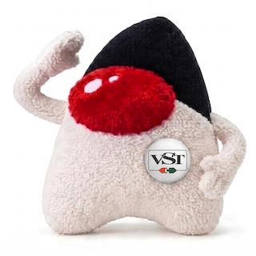

# vavi-sound-vst

vst via jna

## Install

 * [maven](https://jitpack.io/#umjammer/vavi-sound-vst)

## Usage

## References

- [vavi-sound-mdplayer](https://github.com/umjammer/vavi-sound-mdplayer)
- [vavi-sound-amame](https://github.com/umjammer/vavi-sound-amame)

## TODO

---

image designed by @umjammer, drawn by nano banana
